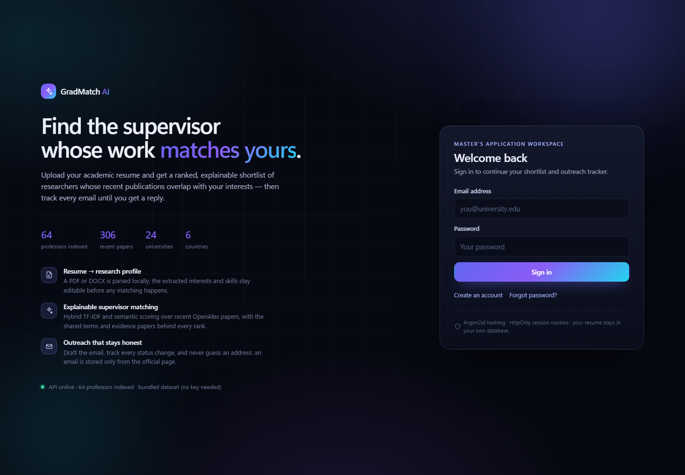
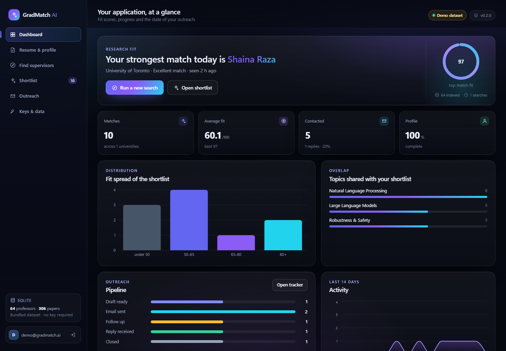
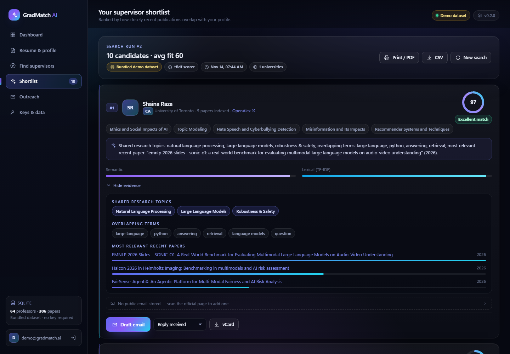
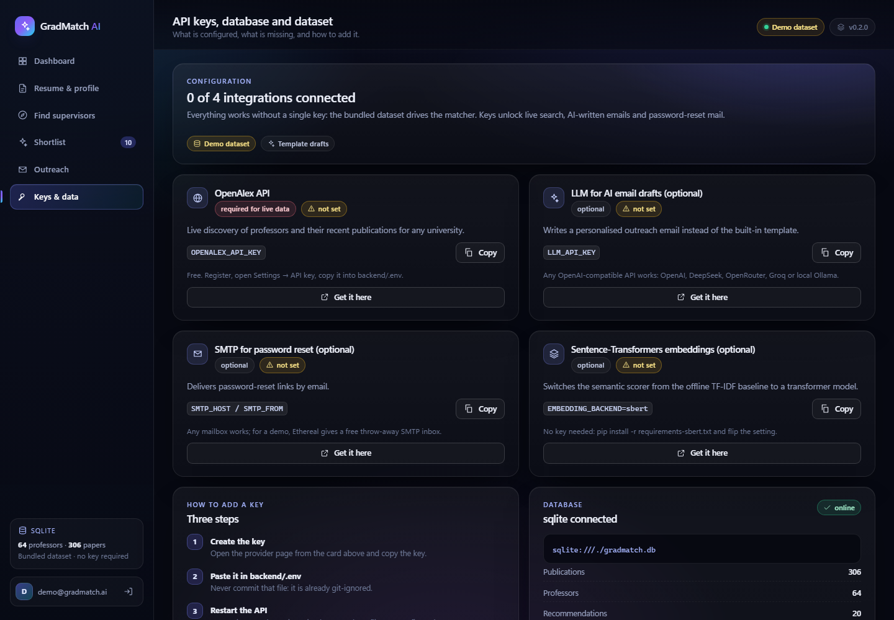

# GradMatch AI

**An explainable supervisor-matching workspace for Master's applicants.**

Upload your academic resume, pick the countries and universities you care about, and get a ranked
shortlist of researchers whose **recent papers overlap with your profile** — with the exact shared
terms and evidence papers behind every score. Then draft the outreach email and track every reply.

> **Status: v0.2 — runs locally with zero credentials.** A bundled sample of 64 professors and
> 306 OpenAlex papers powers the identical matching pipeline when no API key is configured, so the
> demo never depends on the network. Add a free OpenAlex key for live, any-university search.



| Dashboard | Shortlist with evidence |
|---|---|
|  |  |

---

## What is new in v0.2

| Area | Change |
|---|---|
| **UI** | Complete redesign: dark "research intelligence" theme, sidebar workspace, dashboard with charts, match cards with fit rings, evidence panels, print/PDF layout, CSV and vCard export |
| **Offline demo mode** | `data/raw/*.csv` is seeded into the database on first start; ranking runs on the local dataset when no OpenAlex key exists (and as a fallback when the API fails) |
| **Database** | Additive migrations at start-up, DB inspector page (table row counts, dialects), PostgreSQL still supported unchanged |
| **Analytics** | `GET /api/students/{id}/overview` and `/runs`: fit distribution, topics, outreach funnel, 14-day activity, profile completeness |
| **Run history** | Every search run is stored; `GET /api/students/{id}/recommendations/{run_id}` re-opens an older shortlist |
| **AI drafts (optional)** | `POST /api/outreach/{id}/draft` rewrites the deterministic template with any OpenAI-compatible LLM and falls back safely when no key is set |
| **Coverage** | 24 universities in 6 countries (Canada, US, UK, Germany, Netherlands, France) |
| **Docs** | [`docs/API_KEYS_FA.md`](docs/API_KEYS_FA.md) (Persian key guide) and [`docs/DEFENSE_SCRIPT_FA.md`](docs/DEFENSE_SCRIPT_FA.md) (defence video script + likely questions) |

---

## Quick start (Windows, one command)

```powershell
.\start-dev.ps1 -Setup
```

That creates the virtual environment, installs dependencies, writes `backend\.env` with a fresh
`SECRET_KEY`, starts the API on `:8000` and the web app on `:5173`, and opens the browser.

After the first run:

```powershell
.\start-dev.ps1
```

### Demo account (profile + shortlist + outreach history already populated)

```powershell
cd backend
.\.venv\Scripts\python.exe ..\scripts\seed_demo_user.py
```

```
demo@gradmatch.ai / gradmatch-demo-2026
```

See [`docs/DEFENSE_SCRIPT_FA.md`](docs/DEFENSE_SCRIPT_FA.md) for a scene-by-scene recording guide.

### Manual start

```powershell
# 1) API
cd backend
.\.venv\Scripts\python.exe -m uvicorn app.main:app --port 8000     # http://localhost:8000/docs

# 2) web
cd frontend
npm.cmd run dev                                                    # http://localhost:5173
```

### Tests

```powershell
cd backend
.\.venv\Scripts\python.exe -m pytest
```

42 tests, no network access required.

---

## API keys — what is required

| Key | Required? | What it unlocks | Where to get it |
|---|---|---|---|
| `OPENALEX_API_KEY` | for **live** search | Professors + recent papers from any university | <https://openalex.org/settings/api> (free) |
| `LLM_API_KEY` | optional | AI-written outreach email from the match evidence | OpenAI / DeepSeek / OpenRouter / Groq / local Ollama |
| `SMTP_*` | optional | Password-reset email | Ethereal (free test inbox) or any mailbox |
| `EMBEDDING_BACKEND=sbert` | optional | Transformer embeddings instead of TF-IDF | no key, model downloads once |

Full instructions with screenshots of each provider page: **[`docs/API_KEYS_FA.md`](docs/API_KEYS_FA.md)**.
Inside the app, the **Keys & data** page shows live status for each integration.



---

## How the matching works

```
resume ──► text extraction (PyMuPDF / python-docx) ──► rule-based profile (editable)
                                                            │
professors + recent works ◄── OpenAlex (live)  ◄────────────┤
        or bundled dataset ◄── data/raw/*.csv                ▼
                                            hybrid scorer (TF-IDF + optional SBERT)
                                                            │
                    score, shared terms, matched topics, evidence papers
```

- `score = α · semantic + (1 − α) · lexical`, with `semantic = 0.5 · profile similarity + 0.5 · mean(top-3 paper similarities)`
- **Every explanation is derived from the same numbers**: shared terms are the largest TF-IDF
  contributions, evidence papers are the highest-similarity works, topics come from an 18-topic
  taxonomy intersected between student and professor text.
- The **0–100 fit** shown in the UI is a monotone rescale of the raw cosine inside the current
  candidate pool (display only — the ranking is unchanged). The Method panel in the shortlist says so.

### API surface added in v0.2

| Method | Path | Purpose |
|---|---|---|
| `GET` | `/api/meta/stats` | database, table counts, dataset coverage, integration status |
| `GET` | `/api/meta/integrations` | which keys are configured + signup URLs |
| `POST` | `/api/meta/seed` | (re)load the bundled dataset, idempotent |
| `GET` | `/api/students/{id}/overview` | dashboard aggregates |
| `GET` | `/api/students/{id}/runs` | search history |
| `GET` | `/api/students/{id}/recommendations/{run_id}` | re-open a past shortlist |
| `POST` | `/api/outreach/{id}/draft` | AI draft with template fallback |

---

## Project layout

```
GradMatch-AI/
├── backend/            FastAPI app, services (matcher, discovery, demo, llm), tests
│   └── app/data/       universities.json (24 universities)
├── frontend/           React + Vite interface, single design-system stylesheet
├── data/raw/           the bundled 64-professor / 306-paper sample (committed)
├── docs/               API_KEYS_FA, DEFENSE_SCRIPT_FA, architecture, roadmap, screenshots
├── research/           research questions and evaluation plan
├── scripts/            collect_sample.py, seed_demo_user.py, resolve_institutions.py
├── start-dev.ps1       one-command local start (Windows)
├── docker-compose.yml  PostgreSQL + backend + nginx frontend
└── .env.example
```

## Configuration

All settings live in `backend/.env` (see `.env.example`). Highlights:

| Variable | Default | Purpose |
|---|---|---|
| `SECRET_KEY` | — | signs session cookies (32+ chars) |
| `DATABASE_URL` | `sqlite:///./gradmatch.db` | SQLite locally, PostgreSQL in Docker |
| `OPENALEX_API_KEY` | empty | live search; empty = bundled dataset |
| `DEMO_MODE` / `AUTO_SEED_DEMO` | `true` | seed `data/raw` on first start and rank locally |
| `EMBEDDING_BACKEND` / `HYBRID_ALPHA` | `tfidf` / `0.6` | scorer choice and semantic weight |
| `MAX_UNIVERSITIES_PER_RUN` | `5` | protects the OpenAlex budget |
| `LLM_API_KEY` / `LLM_BASE_URL` / `LLM_MODEL` | empty | optional AI email drafting |

Never commit `.env` or `*.db`; both are ignored.

## Known limitations

- OpenAlex does not say who is current faculty or who is accepting students. Results are
  **candidates**, not admission or funding predictions — the UI says this in three places.
- Evaluation is currently qualitative (evidence relevance, rank stability across backends). A
  human-labelled evaluation set is the next research step.
- Before any public launch: rate limiting, email verification, HTTPS with `COOKIE_SECURE=true`,
  managed PostgreSQL with backups, and a working SMTP.
- Scanned PDFs without a text layer are rejected (no OCR).

## Author

Mobina Saedi — Computer Engineering undergraduate, Islamic Azad University, Central Tehran Branch.
GitHub: <https://github.com/mobinasaedi> · Website: <https://mobinasaedi.github.io>

## Documentation

| Document | What is inside |
|---|---|
| [`docs/ARCHITECTURE.md`](docs/ARCHITECTURE.md) | data sources, recommendation flow, scoring, caching, testing |
| [`docs/API_KEYS_FA.md`](docs/API_KEYS_FA.md) | step-by-step key guide *(Persian)* |
| [`docs/DEFENSE_SCRIPT_FA.md`](docs/DEFENSE_SCRIPT_FA.md) | 6–7 minute demo script and expected questions *(Persian)* |
| [`docs/SRS_v1_MVP.md`](docs/SRS_v1_MVP.md) | original requirements and scope |
| [`docs/ROADMAP.md`](docs/ROADMAP.md) | what comes after the MVP |
| [`research/`](research/) | research questions, methodology, dataset schema |

Screenshots live in [`docs/screenshots/`](docs/screenshots).

## Citation / contact

If you use this project or the matching approach in academic work, please link back to this
repository. Questions and issues are welcome through GitHub.

